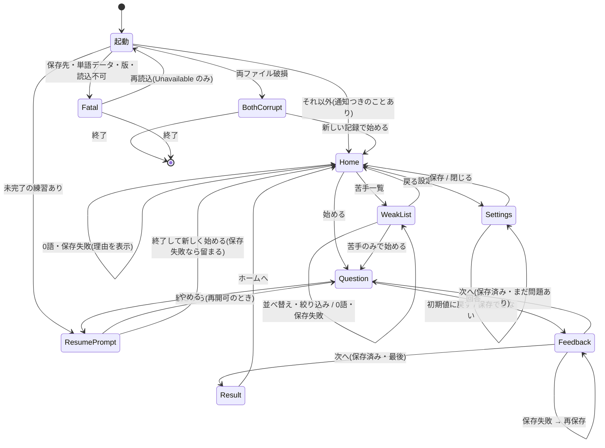

# 第2工程: UX 設計(画面遷移・ユーザーフロー・UX 要件)

- 作成: 2026-11-14
- 状態: **承認済み(2026-11-14、ユーザー)**。10章の Q-UX1〜7 はすべて AI の暫定案どおり、UX-1〜15 を承認
- 前提: 第1工程で WPF を再確認(docs/DECISIONS.md「UI 技術」)
- この文書は「操作体験」を決める。色・フォント・配置などの見た目は第3工程で扱う
- 根拠: `EikenSpelling.Flow`(FlowScreens.cs / PracticeFlow.cs / PracticeFlow.Settings.cs)と 仕様 v1.0 の 3・4・6・10・11・12・16 章

---

## 1. 設計の前提(Flow が決めていること。UX で変えない)

| # | 前提 | 出典 |
|---|---|---|
| P1 | 画面の状態は Flow が持つ。UI は表示して操作を渡すだけ。今の画面で受け付けない操作は例外になる | PracticeFlow.Require |
| P2 | 1問ごとに保存する。保存できない間は「次へ」「やめる」を受け付けない(再保存か、アプリを閉じるだけ) | PracticeFlow.Answer / Next |
| P3 | 練習をやめると「再開の選択」へ戻る(ホームへは戻らない) | PracticeFlow.Quit |
| P4 | 再開できない練習は「終了して新しく始める」だけ | ResumeCheck |
| P5 | 練習ごとの選択は保存しない。基本設定は設定画面で保存したときだけ | DECISIONS「進行役 Flow」 |
| P6 | 誤答入力・パスを画面の状態ごとログに出さない | DECISIONS「進行役 Flow」 |
| P7 | 時間の計測(フラッシュの表示秒数)と音声再生は UI の責務。Flow は `FlashSeconds` を渡すだけ | 仕様 v1.0 15.4 |

---

## 2. 画面一覧(Flow の9画面と仕様の画面の対応)

| Flow の画面 | 仕様 16.1 | 役割 | 出る条件 |
|---|---|---|---|
| `HomeScreen` | ホーム + 練習設定 | 学習状況、練習の開始、苦手一覧・設定への入口 | 起動後(未完了の練習なし)/ 結果・一覧・設定から戻る |
| `WeakListScreen` | 苦手一覧 | 苦手・克服済みの単語、並べ替え、苦手のみ練習の開始 | ホームから |
| `SettingsScreen` | 練習設定(基本設定の保存) | 基本設定の確認・保存・初期値に戻す | ホームから |
| `ResumePromptScreen` | 途中再開の選択 | 続きから / 終了して新しく始める | 起動時に未完了の練習がある / 練習をやめた直後 |
| `QuestionScreen` | 出題画面(再練習を含む) | 1問の表示と入力 | 練習中 |
| `FeedbackScreen` | 判定画面 | 正誤・正しいスペル・差分・保存失敗 | 回答の直後 |
| `ResultScreen` | 結果画面 | 集計、苦手状態の変化 | 最後の問題の判定の後 |
| `BothCorruptScreen` | 両ファイル破損時の選択 | 新しい記録で始める / 終了 | 起動時 |
| `FatalScreen` | 保存失敗(起動時の致命) | 理由の表示、(Unavailable だけ)再読込 / 終了 | 起動時 |

起動時の通知(`Notices`: バックアップから復旧した、など)は最初の画面の上に表示する。

---

## 3. 画面遷移図

---

## 4. ユーザーフロー

### 4.1 基本フロー(通しの練習)
1. 起動 → ホーム(学習状況が見える)
2. 練習設定を確認(初期値は保存済みの基本設定)→「始める」
3. 出題: 問題を見る → 英単語を入力 → Enter
4. 判定: 正誤・正しいスペル・間違えた位置を見る → Enter(次へ)
5. 3・4 を通常問題の数だけ繰り返す(誤答した単語は、通常問題の後に再練習として続く)
6. 結果: 正答数・誤答単語・苦手状態の変化 → ホームへ

**操作回数**(通常10問、すべて既定の設定)
- 開始まで: 1回(「始める」)
- 1問あたり: 入力 + Enter + Enter = キー操作2回(入力文字を除く)
- 結果からホームへ: 1回

### 4.2 モード別の1問の流れ
| モード | 表示 | 入力 | 備考 |
|---|---|---|---|
| 日本語 | 日本語の意味 | 英単語全体 | |
| 音声 | 再生ボタン(何度でも)| 英単語全体 | 英語音声が無い環境では使えない理由を表示(仕様 3.1) |
| 穴あき | 一部を隠した単語 + 文字数 | 全スペル | |
| フラッシュ | 単語を指定秒数だけ表示 | 表示が終わってから入力開始 | 表示中は入力欄を出さない(仕様 3.4)。表示・計時は UI の責務 |

再練習の問題は「再練習」と分かる表示を付ける(`QuestionView.IsRetry`)。再練習は通常の問題数に含めない(仕様 6.2)ので、「n / 合計」の合計は途中で増える(Flow の `Total`)。増えることを画面で説明する。

### 4.3 途中再開
- 起動時に未完了の練習があれば、ホームの前に「再開の選択」を出す(何問中何問答えたか、開始日時)
- 「続きから」→ 次の未回答の問題へ。「終了して新しく始める」→ 回答済みの記録は残してホームへ
- 再開できない場合は「終了して新しく始める」だけを選べ、理由を表示する(P4)
- 練習中の「やめる」→ 再開の選択へ(P3)。UX 上の違和感があるため **Q-UX2** で確認する

### 4.4 保存失敗(練習中)
1. 回答すると判定画面が出る。保存に失敗していたら、正誤は見せたうえで「保存できませんでした」と再保存ボタンを出す
2. 保存できるまで「次へ」は押せない(無効にして、理由を文で出す)
3. 直らないときはアプリを閉じる。最後に保存できた問題から再開できる(Flow の文言)

### 4.5 起動時の異常
| 状態 | 見せるもの | 操作 |
|---|---|---|
| バックアップから復旧 | ホーム(または再開の選択)の上に通知 | 通知を閉じる |
| 両ファイル破損 | 説明(壊れたファイルは残す)| 「新しい記録で始める」/ 終了。誤って押さないよう確認を1段入れる |
| 保存先が使えない・単語データが壊れている・新しすぎる版 | 理由 | 終了のみ |
| 読込できない(一時的)| 理由 | 再読込 / 終了 |

---

## 5. キーボード操作・フォーカス

原則: **マウスなしで1回の練習を最後までできる。**

| 画面 | 初期フォーカス | キー | 備考 |
|---|---|---|---|
| ホーム | 「始める」ボタン | Enter = 始める、Tab で設定項目・苦手一覧・設定へ | 練習設定は Tab で巡れる順に並べる |
| 出題 | 入力欄 | Enter = 回答、Esc = やめる(確認あり)| 空欄の扱いは **Q-UX4**。音声モードは再生に Ctrl+Space など(第3工程で決める)|
| フラッシュの表示中 | (入力欄なし)| なし | 表示が終わったら入力欄を出し、フォーカスを移す |
| 判定 | 「次へ」ボタン | Enter = 次へ(保存失敗のときは「再保存」)| 回答の Enter の直後に誤って次へ進まない工夫を **Q-UX3** で確認 |
| 結果 | 「ホームへ」| Enter | |
| 再開の選択 | 「続きから」(可能なとき)/「終了して新しく始める」 | Enter / Tab | 破壊的でない側を初期フォーカスにする |
| 苦手一覧 | 並べ替え | Tab / 矢印、Enter = 苦手のみで始める | Esc = 戻る |
| 設定 | 先頭の項目 | Tab、Enter = 保存、Esc = 閉じる | 保存できないときは理由を表示 |

**日本語 IME**: 回答欄は英字入力専用にする。IME が日本語入力のままでも、確定前の文字が回答に混ざらないようにする(回答欄では IME を無効にする案。第5工程の実機テストで確認)。

---

## 6. アクセシビリティ

| # | 内容 |
|---|---|
| A1 | キーボードだけで全画面を操作できる。フォーカスの位置が常に見える |
| A2 | 正誤は色だけで伝えない(「正解」「不正解」の文字と記号も出す) |
| A3 | 差分は文章でも出す(例: 「6文字目の m が不足しています」)。色・下線だけに頼らない |
| A4 | 文字サイズは読みやすい大きさを標準にする。Windows の拡大設定・高 DPI で崩れない |
| A5 | コントラストは文字と背景で十分に取る(基準は第3工程で決める。WCAG AA を目安) |
| A6 | 各ボタン・入力欄にスクリーンリーダー用の名前を付ける |
| A7 | 画面が切り替わったとき、フォーカスを次の操作の場所へ移す |
| A8 | 通知・エラーは自動で消さない(閉じる操作で消す)。フラッシュの時間は設定で変えられる(0.5〜2秒、`FlashSeconds`)|

---

## 7. 例外フローのまとめ

| 状況 | UI の振る舞い | 根拠 |
|---|---|---|
| 0語(出せる問題がない) | ホーム(または一覧)に理由の文言を出して留まる | `EmptyReason` |
| 練習の開始時に保存できない | ホーム(または一覧)に文言を出して留まる | `StartFailedMessage` |
| 回答の保存失敗 | 判定画面で再保存。「次へ」は無効 | P2 |
| 設定を保存できない | 設定画面に理由。保存ボタンを無効 | `SettingsScreen.CanSave` |
| 端末で使えないモード | 選択肢から外すか、使えない理由を表示 | `AvailableModes` |
| 受け付けない操作 | **画面側で押せないようにする**。例外を利用者に見せない | `Require` |
| 想定外の例外 | 内容を伏せた通知を出し、ログに残して終了する。学習記録は壊さない(保存を試みない)| logging.md、UI 設計 7章(H1)|
| 連打・押しっぱなし | 画面が変わった後に届いた古い操作は何もしない(例外にしない)| レビュー P0-2 |

---

## 8. 既存 Flow との整合の確認(第2工程で見つけた点)

| # | 観察 | 扱い |
|---|---|---|
| G1 | 判定画面から「やめる」ができない(`Quit` は出題画面だけ)。保存失敗中はアプリを閉じるしかない | 仕様どおり(P2)。画面の文言で伝える |
| G2 | 最後の問題の判定画面の「次へ」は結果へ進む。ボタンの文言は「結果を見る」のほうが分かりやすい | UX の表現で対応。Flow は変えない |
| G3 | 「やめる」で再開の選択に戻る(ホームではない) | **Q-UX2** |
| G4 | フラッシュの表示・隠す・入力開始のタイミングは Flow に操作がない | UI(計時)の責務。ただし「表示後に見直したい」の扱いは仕様に無い。**Q-UX5** |
| G5 | 空欄で回答できるか | 確認済み(第4工程): Flow は空欄・空白だけを誤答として記録する(FlowPracticeTests の Empty_input_is_a_wrong_answer)。Q-UX4 A のとおり、UI は空欄・空白だけの入力を送らない。「空か」の判定は Core に1つだけ置く(レビュー P0-1)|
| G6 | 練習設定が仕様では独立した画面、Flow ではホームの `Defaults`。UX 上の置き場所が未決 | **Q-UX1** |

---

## 9. UX 要件(承認対象)

| # | 要件 | 優先 |
|---|---|---|
| UX-1 | ホームから「始める」まで、既定の設定で1操作 | Must |
| UX-2 | 1問の流れ(入力 → Enter → 判定 → Enter)がキーボードだけでできる | Must |
| UX-3 | 判定画面で、正誤・正しいスペル・間違えた位置を文章でも示す | Must |
| UX-4 | 保存失敗のとき、利用者のデータが失われないことと次の操作を示す。「次へ」は無効 | Must |
| UX-5 | 起動時の通知(復旧・新しい記録)を、閉じるまで表示する | Must |
| UX-6 | 両ファイル破損の「新しい記録で始める」は確認を1段入れる | Must |
| UX-7 | 再開の選択では、どこまで進んだかを示す。再開できない理由を表示する | Must |
| UX-8 | 再練習の問題であることと、合計が増えることを示す | Must |
| UX-9 | 回答欄は英字入力専用で、IME の確定前の文字が回答に混ざらない | Must |
| UX-10 | 画面を切り替えたとき、次に操作する場所にフォーカスが移る | Must |
| UX-11 | 正誤・差分は色だけで伝えない。高 DPI・拡大で崩れない | Must |
| UX-12 | 例外ダイアログで落ちない。想定外の例外は伏せた文言で通知しログに残す | Must |
| UX-13 | 音声・フラッシュのモードは、使えない理由が分かる | Should(音声・フラッシュは骨組みの後)|
| UX-14 | 苦手一覧から、苦手のみの練習を1操作で始められる | Should |
| UX-15 | 設定画面で、保存できないときに理由が分かる | Should |

---

## 10. 人間に決めてほしいこと

| # | 質問 | 選択肢 | AI の暫定案 |
|---|---|---|---|
| Q-UX1 | 練習設定(自動ミックス/手動・問題数・苦手のみ)の置き場所 | A. ホームに同居(1操作で始められる)/ B. 「始める」で別画面へ(仕様 16.1 に近い) | A |
| Q-UX2 | 練習中の「やめる」の戻り先 | A. 今の Flow どおり再開の選択へ(「続きから」が目の前に出る)/ B. ホームへ戻り、再開は次回起動時だけ(Flow の変更が要る) | A(Flow を変えない)。ただし「やめる」の前に確認を1段入れる |
| Q-UX3 | 回答の Enter の直後に、誤って次へ進まない工夫 | A. 判定画面が出て約 0.3 秒は Enter を無視 / B. 工夫なし / C. 判定画面の「次へ」はマウス・別キー | A → **改訂(2026-11-14、ユーザー承認)**: どの画面も、今の画面になってから約 0.3 秒は Enter・クリックを受け付けない(文字の入力は対象外)。保存中に溜まったクリックや素早い Enter が次の画面のボタンを押すのを防ぐため(設計レビュー)|
| Q-UX4 | 空欄のまま Enter | A. 何も起きない(誤答にしない)/ B. 誤答として記録 | A(確認は第4工程) |
| Q-UX5 | フラッシュモードの「もう一度見る」 | A. なし(1回だけ。仕様どおり)/ B. あり | A |
| Q-UX6 | 音声モードの再生 | A. 問題表示時に自動で1回 + 再生ボタン / B. 再生ボタンだけ | A |
| Q-UX7 | ウィンドウの形 | A. 固定の大きさ(集中して使う)/ B. 自由に拡大縮小 | B(高 DPI・拡大対応は必須) |

AI が補う軽微な事項(質問しない): ボタンの文言、ショートカットの割り当て、通知の見せ方の細部。

---

## 11. 次の工程
- 第2工程の承認(上の Q-UX1〜7 の判断と、要件 UX-1〜15 の承認)が出たら、第3工程(UI デザイン案 3〜5案の作成)へ進む
- 承認されるまで、画面の見た目の確定・実装には進まない
